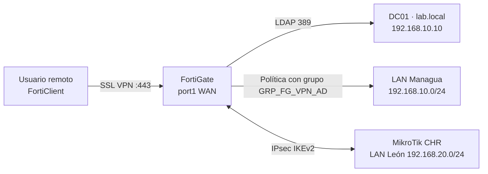

# VPN remota con usuarios de Active Directory: Windows Server 2022 + FortiGate


Laboratorio de infraestructura documentado paso a paso: un controlador de dominio **Windows Server 2022 (`DC01`)** autentica por **LDAP** a usuarios de **Active Directory** en un **FortiGate**, que los autoriza por pertenencia a grupo para una **VPN SSL de acceso remoto**. Forma parte de un laboratorio mayor con un túnel **IPsec IKEv2** entre FortiGate y MikroTik.

> **English summary:** a hands-on lab where a Windows Server 2022 domain controller (AD DS + DNS) authenticates users over LDAP for a FortiGate SSL VPN, with group-based authorization. Fully documented in Spanish with screenshots, validation steps and a troubleshooting log, including the issues that are still open.

## Qué demuestra este proyecto

- Instalación y promoción de un controlador de dominio (AD DS + DNS integrado, reenviador, registros SRV).
- Diseño de una estructura de AD: OU, grupos de seguridad, cuenta de servicio de mínimo privilegio.
- Integración FortiGate ↔ Active Directory por LDAP, con **separación entre autenticación y autorización**.
- Configuración de SSL VPN (portal, túnel dividido, política de firewall con grupo como origen y NAT desactivado).
- Diagnóstico metódico: cada problema se registra con síntoma, causa, solución y estado.
- Documentación pensada para quien está empezando: qué se hace, por qué, cómo, cómo se valida.

## Arquitectura



| Componente | Detalle |
|---|---|
| Hipervisor | VMware Workstation |
| Controlador de dominio | Windows Server 2022 Datacenter, 4 GB RAM, IP estática, dominio `lab.local` |
| Firewall | FortiGate-VM64 v7.0.15 (licencia de evaluación) |
| Router remoto | MikroTik CHR 7.25 |

## Estado del proyecto

| Componente | Estado |
|---|---|
| Base del servidor (IP fija, DNS, hora, RAM) | Validado |
| Dominio, DNS y registros SRV | Validado |
| Estructura de AD (OU, usuarios, grupo, cuenta de servicio) | Validado |
| LDAP FortiGate ↔ DC01 y credenciales | Validado |
| Autorización por grupo (un usuario permitido, otro no) | Verificada por diagnóstico; falta con el VPN real |
| Portal, ajustes y política del SSL VPN | Configurados |
| Conexión SSL VPN de extremo a extremo | **Abierto**: falla la negociación TLS en el puerto 443 |

El fallo TLS está documentado con sus evidencias y una hipótesis **sin confirmar** (posible restricción de cifrado de la licencia de evaluación). Los siguientes pasos son el debug del SSL VPN y la prueba con FortiClient.

## Problemas reales documentados

El manual incluye un registro con 19 entradas. Algunos ejemplos:

- Ping a una IP funcionaba pero `nslookup` fallaba: **Internet por IP no es lo mismo que DNS**.
- La promoción del dominio fallaba por un Administrador local sin contraseña.
- La prueba de credenciales de la interfaz del FortiGate no muestra grupos; la autorización se comprobó con un comando de diagnóstico de solo lectura.
- El FortiGate rechazó crear un portal nuevo («máximo de objetos») y se resolvió reutilizando el existente.
- Una corrección de diseño: el SSL VPN se movió al puerto 443 porque la administración ya usaba 10443.

## Contenido del repositorio

```text
.
├── README.md
└── docs/
    └── manual_AD_VPN_remota_FortiGate.html   # manual completo con capturas
```

El manual es un único archivo HTML autocontenido. GitHub no lo renderiza en el visor: descárgalo y ábrelo en el navegador, o publícalo con GitHub Pages.

## Próximos pasos

- [ ] Cerrar el diagnóstico TLS y completar la prueba de conexión de extremo a extremo.
- [ ] Endurecimiento: LDAPS (636), MFA con FortiToken, servicios mínimos en las políticas, certificado propio.
- [ ] Nuevo laboratorio con **MikroTik como equipo principal**: autenticación contra RADIUS (NPS en Windows Server) con usuarios de AD. *(Propuesta de diseño, aún no validada.)*

## Aviso

Es un entorno de laboratorio. No contiene credenciales, claves ni direcciones públicas, y las capturas se publican con los datos sensibles ocultos. Las configuraciones con LDAP sin cifrar y certificados de fábrica son solo para pruebas; no deben usarse así en producción.

## Autor

**Nestor Moreira** · Infraestructura y redes
[LinkedIn](https://www.linkedin.com/in/TU-PERFIL) · Abierto a nuevas oportunidades
